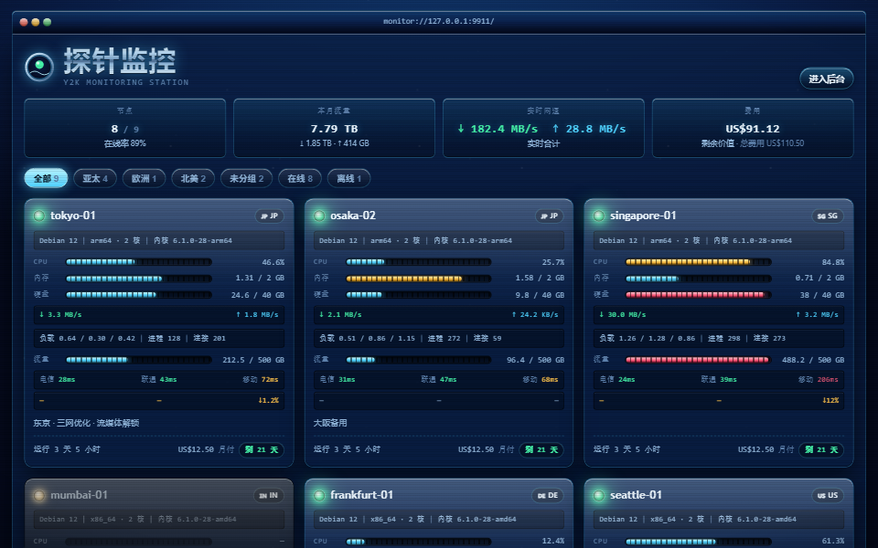

# 千禧年 Y2K — 探针监控主题

千禧年复古未来主义探针主题：铬合金、水蓝玻璃、霓虹与扫描线。纯静态 SPA，无 Web 字体、无图片资源（站点图标除外），全部视觉由 CSS 渐变与 SVG 手绘完成。

13 套配色（Aqua 水蓝玻璃 / Chrome 液态铬 / Vaporwave 蒸汽波 / Matrix 终端绿 / Bubble 果冻粉 / Amber 琥珀单色 / Ice 冰蓝工作站 / Sunrise 千禧日出 / Luna XP 蓝绿 / Silver 银灰经典 / Panther 苹果蓝 / Graphite 石墨金属 / Contrast 高对比）、8 种背景（星空 / 透视网格 / 星空+网格 / 千禧日落 / 极光 / 数字雨 / 地平线 / 纯色）、CRT 扫描线、分段 LED 进度条、手写 SVG 图表，以及对比度、字号与真实硬件无关的节点卡片：三网延迟、丢包、流量配额、费用与到期。

## 安装

三种方式，任选其一（主题可在面板的「主题」页随时切换，不用重启）：

1. 在面板「主题」页填本仓库地址，点「从 GitHub 安装」——取的是最新正式 release 里的 `theme.tar.gz`；
2. 下载 release 里的 `theme.tar.gz`（**不是** Source code 压缩包）后上传；
3. 把主题目录直接放进 hub 的 `--themes` 目录（一键脚本部署是 `/opt/monitor/data/themes/`）。

## 路由

| 路径 | 页面 |
| --- | --- |
| `/` | 节点列表 |
| `/node/{id}` | 单节点详情（资源图表 / 延迟） |

按路径放行的反向代理或 WAF 需要允许上面两条；`/admin`、`/api`、`/install.sh`、`/agent/*` 由 hub 自己处理。

## 作者

poooo · [github.com/bluesmkun/y2k](https://github.com/bluesmkun/y2k)

## 许可证

[MIT](LICENSE)
